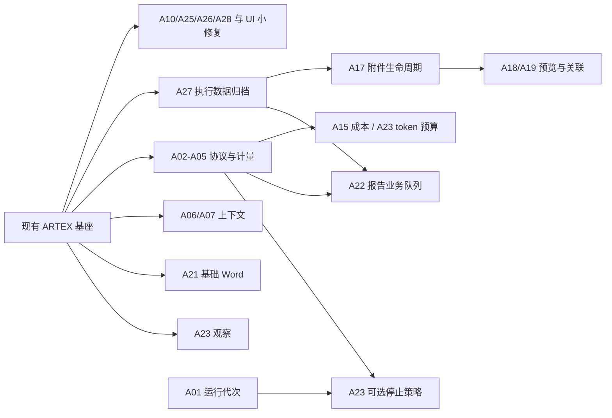

# ARTEX 引入 Pojun 能力的实施、优化与兼容方案

首批源码实现状态见 [0.3.21 交付记录](POJUN_FOUNDATION_DELIVERY.md)，其余条目仍是后续设计。

版本：设计 v2，2026-11-12。ARTEX 源码基线 `edf7c99`（前序文档提交 `938d83e`），Pojun 基线 `dc9b83ea125bb54c69dd38be5c29c26d8e83b811`（v0.4.63），依赖参考 Norma v0.4.4。

**建议：先补归档与执行恢复的数据衔接及工作区系统目录保护；模型协议、参数和 UI 小修复独立交付；上下文效率、证据/报告分别推进，主动改变执行行为的功能最后启用。** 不做整仓合并，不换框架，不增加新的调度框架或证据存储。

本文件是可实施设计，尚未实现的接口、字段、阈值均明确为“拟新增/起始值”。不把设计目标表述成已通过的性能结果。源码依据见 [第一轮评估](POJUN_SOURCE_REVIEW.md)、[扩展评估 E01–E18](POJUN_SOURCE_REVIEW_EXTENDED.md)、[第三轮 O01–O13](POJUN_SOURCE_REVIEW_OPERATIONS.md)。第三轮核对了归档、通知、代理、用量、发布、前端请求和现有队列的真实边界；静态确认与待复现结论分开记录。

## v2 相对 v1 的调整

- 新增 A25 通知路由、A26 系统目录保护、A27 执行数据归档、A28 PR 检查与升级边界；代理池归入 X04 条件扩展。A01–A24 编号不变，用量归属、摘要调用兼容、缺失引用和前端竞态并回原条目。
- A27 提到最高优先：当前归档未收录执行恢复四表，删除审批会级联删除它们；spool 也没有随任务打包。先用隔离数据复现，不把它误写成上游已有修复。
- 撤销把报告任务直接挂入 trigger_runs 的设计。它的领取/恢复会创建并处理通用 Agent 会话；改为小型报告业务表，复用同一 DB、受管理 worker 和事务领取模式。
- 依赖精确到子项：Word 基础版只依赖现有证据快照；费用、分类和自动补写不作前置。观察模式可先用现有事实，token 预算只依赖正确计量，不依赖价格功能。
- 压缩成功块先在当前压缩过程有界复用；跨运行持久缓存、预览持久队列、全局 schema 门禁均只在对应风险出现时做。保留短小实现，不先搭通用框架。

## 1. 当前完成状态与不可回退的能力

已本地完成：`3a82997` 的六项执行恢复修复，`edf7c99` 的终态时钟重置、created 状态修正和前端缓存修复。已记录 PostgreSQL 全量测试及构建通过。当前运行安装仍为 0.3.20，后续本地提交尚未部署。

集成必须保留以下契约：

1. 执行是否发生、进程是否退出，以执行器回执为准；模型文本只能解释证据，不能替代回执。
2. 未确认的写操作继续受执行恢复屏障约束；用户/Planner 明确停止不能被后台自动重开。
3. 任务策略优先级、来源任务只读隔离、报告 evidence_version、并发准入与 FIFO 不变。
4. 数据库和内存的任务状态同步提交；删除、暂停、服务退出使用已有运行管理链路。
5. JWT/session epoch、HttpOnly cookie、来源检查、原有 API 和 Windows 便携启动保留。
6. 本次方案不改变线上任何配置。此前对任务 #1 的执行恢复授权不自动扩展为报告补写、目标登录自检或自动收尾授权。

## 2. 完整工作清单

“适配”保留主要实现并做兼容；“改写”保留机制，在本地基座实现。“高/中”表示实施优先级。B0–B7 是工作批次，不是必须串行的整批门禁；X1–X4 是条件扩展。每个批次继续拆成小提交，不能把整张表塞进一个 PR。

| ID | 能力 | 方式/优先级 | 批次 | 主要落点与来源 |
| --- | --- | --- | --- | --- |
| A01 | 运行代次、旧协调器取消、晚到写入隔离 | 本地增强/高 | B1 | server/engine_timeout.go、manager.go、db 任务状态方法；E18 |
| A02 | Gemini 工具调用签名及跨模型历史兼容 | 适配/高 | B1 | third_party/norma/llm、harness、noaadapter |
| A03 | 协议用量归一、调用/意图归属与去重 | 适配/高 | B1 | norma/llm、llmrec、agent/capture.go、db/llm_usage.go |
| A04 | 输出 UTF-8 边界、原文引用与完整性 | 适配/高 | B1 | norma/tool、执行回执输出存储 |
| A05 | 全调用链 thinking 参数兼容与单次降级 | 改写/高 | B1 | agent/provider.go、server/task_llm.go、sidequestion/context.go、server/intercept.go |
| A06 | Worker 专用快照、按需展开、正文预算 | 改写/高 | B2 | agent/tools.go、worker.go、db 查询；E01/E02 |
| A07 | 压缩分块、部分结果复用、失败退避 | 改写/高 | B2 | agent/compaction.go、db/digest.go |
| A08 | MCP 失败冷却和发现去重 | 改写/中 | B3 | server/mcpdiscover.go、assembly.go |
| A09 | 技能索引、元数据和只读工具声明 | 适配/中 | B3 | agent/assembly.go、tools.go、toolcatalog.go、server/skill_tags；E17 |
| A10 | 配置参数校验与 DSL 空值查询 | 适配/高 | B0 | server/server_mgmt.go、platform_tools.go、db/asset_dsl.go；E06/E07 |
| A11 | 类别规范键、原始类别和 CWE 并存 | 改写/中 | B3 | db/findings.go、finding_recorder.go；E08 |
| A12 | 内置提示词/规则版本迁移 | 改写/高 | B3 | db/config.go、内置规则 seed；E11 |
| A13 | 规则级 judge/timeout 的完整语义 | 适配/中 | B3 | intercept、guard、规则 UI；E12 |
| A14 | 结构化失败原因、执行耗时、Planner 诊断摘要 | 改写/高 | B4 | guard、execution receipts、db/activity；E03 |
| A15 | 价格版本与任务成本查询 | 改写/高 | B4 | db/llm_usage.go、server/cost.go、费用 UI；E05 |
| A16 | 只读宿主工具/运行环境/代理诊断 | 适配/中 | B4 | server/platform_tools.go、拟新增诊断模块；E09 |
| A17 | 缺失引用处理、任务附件与 finding 关联 | 改写/高 | B5 | evidence/store.go、拟新增 db/task_artifacts.go |
| A18 | JSON/CSV/JSONL/文本/gzip/ZIP 预览 | 适配并优化/高 | B5 | 拟新增 server/artifact_preview、前端 viewer |
| A19 | 图片缩放、缩略图、Office/PDF 可选预览 | 适配/中 | B5 | 前端独立组件、docpreview 转换器 |
| A20 | 离线响应差分、证据回验、关联建议 | 改写/中 | B5 | evidence 纯函数、finding 工作流；E13/E16 |
| A21 | Word/Markdown 统一交付与证据清单 | 适配并优化/高 | B6 | report、server/finding_traffic_export.go |
| A22 | 可暂停、去重的报告补写 | 改写/高 | B6 | 拟新增 db/report_recovery.go，借鉴事务队列模式；O13 |
| A23 | 软预算、重复调用提示、进度观察、自动收尾 | 改写/中 | B7 | agent/engine 生命周期；E04 |
| A24 | 错误边界、WebView 降级、增量列表与请求去重 | 适配并优化/高 | B0/B5 | web/src/app、hooks、lib/api.ts；E10 |
| A25 | 通知显式路由与全分支拨号守卫 | 适配并补齐/高 | B0 | notify/http.go；O01 |
| A26 | 工作区系统数据保护与内部别名隔离 | 本地增强/高 | B0 | server/workspace.go，保留 os.Root；O05 |
| A27 | 执行回执/恢复历史/spool 的归档与恢复 | 本地修复/最高 | B0 | db/task_archives、server/task_archive_package；O06/O07 |
| A28 | PR 检查前移、升级元数据限额与包成员唯一性 | 适配并优化/高 | B0 | .github/workflows、selfupdate；O09/O10 |
| X01 | 任务凭据配置与显式登录自检 | 可选重写 | X1 | task_auth、任务受控 HTTP 执行；E14 |
| X02 | 只读 NVD/KEV/GHSA 情报和版本候选匹配 | 可选适配 | X2 | vulnintel 数据层与索引；E15 |
| X03 | Playbook 元数据、环境标签和模板筛选 | 可选适配 | X3 | 现有 task_templates、skill 元数据；E17 |
| X04 | 按任务/会话固定身份的多出口代理 | 可选重写 | X4 | traffic/pool 的机制参考，保留当前单出口；O08 |

不作为本轮主线：C2/监听器/SSH 中继、自动安装宿主工具、自动扫描模板、自动复测、品牌/模块/环境变量改名、全局 1M 上下文或固定 65536 压缩输出预算。避免把产品范围扩展混入基础可靠性升级。

## 2.1 首批落地：保护现有数据，缩短修复交付路径

以下子项可以各自形成源码提交和测试记录，不能等 28 项全做完再发布。归档修复比普通 UI 修复复杂，应单独交付；局部代码不需要等待所有新表或功能。

| 次序 | 可审查结果 | 必需验证 |
| --- | --- | --- |
| 1 | A27 隔离归档复现、格式升级、回执/决策/spool 同步保存恢复 | 精确记录集合、hash、未知写屏障、租约、集合范围的往返对比；包写入/DB 提交间失败注入 |
| 2 | A26 系统管理目录在通用文件接口只读，用户产物仍可编辑 | write/upload/mkdir/delete；内部链接、Windows 大小写/junction、任务正式删除不受阻 |
| 3 | A25 通知 Transport/路由，A10 enum/NULL，A28 升级读取边界 | 本地假 HTTP/代理、PG NULL 结果集、超限 JSON/重复包成员；不连接真实目标 |
| 4 | A02/A03/A04/A05 协议小块，A24 错误边界和请求防晚到 | mock 流事件与真实调用去重、UTF-8/存储截断、非 Worker 调用、慢旧响应交错 |
| 持续 | A28 把已有根/Norma/前端检查前移到 PR | PR 无发布令牌、独立测试库；发布仍走 Windows 便携 smoke |

## 3. 代码结构：复用现有边界，不另造平台

| 位置 | 职责 | 不应承担 |
| --- | --- | --- |
| third_party/norma | 协议解析、流事件、工具输出边界、执行观察器 | ARTEX 的任务策略和数据库调度 |
| agent | 按角色组装上下文、工具定义、压缩及摘要 | HTTP 状态码、全局迁移、独立后台守护进程 |
| db | 事务、状态 CAS、分页查询、持久队列、版本检查 | 模型调用、文件转换、外部请求 |
| evidence | 内容哈希、落盘、完整性与引用生命周期 | 凭据配置、重开任务 |
| server | 请求验证、准入和取消、调用上述组件、DTO | 在 handler 中重复拼完整业务事务 |
| report / docpreview | 纯渲染；可取消的本地转换 | 直接查全局资产、触发新探测 |
| web | 展示、交互、请求缓存和失效 | 推测后端状态、从模型文本推测执行成功 |

只在出现第二个实际调用方时提取共享组件。小型受锁状态优先 mutex，不使用发布后仍修改的 atomic.Pointer；不新增通用 DAG 调度框架、全局事件总线或包罗万象的 Repository 接口。新增 DTO 使用明确结构体，逐步替换本次触及的 map[string]any；不顺带重写整个旧模块。

所有网络/数据库/转换操作传 context，后台任务进入现有 background/runTaskRoutine 管理。集合、重试、缓存、队列都有容量和期限；不会因加入“优化”而产生无限 goroutine、无界 map 或隐式全表扫描。

## 4. 模型与运行兼容（B1）

### A01：运行代次

先用晚到 Planner 写回的确定性交错用例定位需要防护的写入口；不让 A01 成为全部协议小修复的门禁。拟新增 `tasks.run_generation BIGINT NOT NULL DEFAULT 1`。首次生成从 1 开始；终态重新准入或明确开启新一轮时在准入事务内递增；普通 pause/resume 不递增、不重置绝对预算。各在途操作持有开始时的 generation。现有 execution_control_version 表示暂停/状态/策略变更，与运行代次职责不同，继续保留，不能互相替代。数据库 fencing 只约束被纳入检查的写入口，不宣称能撤销已经发生的外部副作用。

- 任务状态/Planner 意图写回：同一事务锁定 task 行并检查未删除、generation 匹配、目标前置状态正确，旧轮返回明确的 stale-run 错误，不能自动重试成新轮写入。
- 旧超时协调器：保存可取消句柄，重开时取消旧句柄并清理；新协调器按新 generation 注册。数据库检查仍是最终防线。
- 晚到执行回执：无论 generation 是否旧，都可追加并归属原 execution_id，不能丢掉退出结果；是否恢复任务再走当前策略和版本检查。
- 报告任务：按 finding.evidence_version 独立保护，不能把“原任务已结束”误判成禁止完成已有报告。
- 清理：先阻止新操作，再取消，再有界 drain，最后处理文件。保持现有删除屏障。禁止只让外层超时返回、放任未受管理的 planner goroutine 继续写。

验收需确定性交错：旧轮暂停在提交前→任务结束并重新启动→旧轮释放；旧轮不得修改新轮状态，但旧工具退出回执可见。覆盖 done/failed/timeout、FIFO、服务关停和删任务。

### A02–A05：保留协议扩展，统一重试边界

按源码小块移植到固定 Norma，不把 go.mod 的 replace 改回远程 fork。为每个修改记录上游版本/函数和本地差异，直接改源码，不生成运行时补丁。

- thought_signature 从流解析、并行 tool index、累积器、harness 输出、transcript、历史重放一贯保留；仅在适用协议输出。跨 Anthropic 请求剥离不支持字段但不修改原历史。对于严格的兼容网关，按 provider 能力配置处理扩展，不靠 URL 包含 google 判断。
- 用量先在协议适配层转成明确语义：输入/缓存的 echo 去重，累计输出与增量输出明确区分。不能把所有协议都无条件套一条 max/add 规则。完成/失败/中断都输出单次调用事实。沿 llmrec.WithTaskID/WithWorker 增补 intent_id、call purpose、call_id/attempt_id；task/exploration/intent 关系由实际调用上下文给出并验证，session 后缀只是严格校验后的旧数据回退。llmrec 为唯一入账来源，harness/activity 仅作投影；SUM 用真实 cache_read/cache_write 列且统一缓存口径。
- 输出截断按 UTF-8 边界处理；主存储保存限额内原文，显示层保留头尾和引用。区分显示截断与存储截断；存储达到上限时保存完整性标识及实际字节数，不能把部分输出标为可靠全文。绝对路径只在内部工具环境使用；恢复审阅和前端用 execution/artifact ID 解析，不能把模型给的任意路径直接拿来读文件。
- thinking 覆盖 worker/planner/goals/reporter、sidequestion 摘要、compactor 和 judge；用明确调用目的组装有效参数，不能只改默认 provider 而遗漏 request override。降级只认明确参数拒绝，最多一次；重建临时 provider，同时处理 profile 和单次 request override。已有可见输出或已执行工具时不重放。取消、配额耗尽、凭据错误、未知 400 不参与该降级。
- 维持已有 client_compat、session header、工具审批、连接池和 profile failover。provider 缓存键至少包含 profile ID/版本、wire format、有效参数；编辑配置统一失效。
- 不自动修改用户保存的模型窗口/预算，不用 Pojun 的单一模型经验为全部模型设置新默认值。

测试使用本地 mock SSE/HTTP 服务，覆盖三种协议、并行签名晚到、usage 仅在 delta、重复 echo、stream/non-stream、取消后不重试、跨 provider 历史、中文/emoji 截断、磁盘不可写和嵌套工具回执。

## 5. 查询与上下文效率（B2）

### A06：WorkerSnapshot

拟在 agent 定义明确的 WorkerSnapshot，由 db 提供有界读取。内容包括当前 intent/detail、有效约束与范围、相关父节点/事实、少量近期 findings/facts、来源任务的只读摘要、待核验执行和全文引用。必须保留来源及 confidence，不能用“瘦身”删掉约束或把继承资料变成本任务授权。

查询结构：一条聚合 count + 按任务/类型/排序列取有限摘要；必要时用一条多 CTE 投影。禁止先拿 1000 个完整节点再 count；禁止为 Worker 构建完整 coldGraph 后删字段。摘要采用稳定顺序和固定分段，减少无关前缀变化。

起始验收预算：当前任务快照最多 4 次 SQL 往返；继承任务批量读取，查询次数不随来源任务数量线性增加。软目标为非必要摘要最多 8k 估算 token；约束超预算必须报告超限并分层加载，不能静默截掉。完整 detail、证据和相关节点通过现有只读工具按需展开。

现有 graph_overview API 保留。新增内部快照不改变旧响应。相关读取使用已有只读/并发工具标记；每个工具要逐个检查实际副作用，不能按名称含 get/list 就判断只读。

### A07：压缩不重复付费、不抢主任务资源

按估算 token 而非固定 6 个节点分块，成员数量作为二级上限。先同步确定分块与输入指纹，再交给有界 worker pool；起始并发 2，总输出/时间受独立压缩预算控制并遵守 provider 限流。

可复用的块结果以 `(exploration_id, input_hash, prompt_version, provider_config_revision)` 定位；输入包含节点版本、关系、置信度与顺序。首版只在当前压缩过程的有界内存里保留成功块，重试补缺块；过程结束释放。不会把尚未成功的块标为已压缩；最终 digest 重新检查节点版本和热节点，涉及跨运行写入时再检查 A01 代次，冲突则保留原节点视图。

只有重启/跨次重复摘要费用的基准证明有收益，再加独立小表和字节/记录限额、TTL；它是可丢弃缓存，不归档、不作为事实来源。不能为首版分块增加默认必需的持久层。

失败退避采用有上限的指数退避与少量抖动；取消、暂时无模型与实际模型失败分别计数。每次压缩有预算上限，后台停止受服务 ctx 管理，不使用无条件 WithoutCancel。先做分块和重试基准，跨运行缓存确有收益后再启用，避免为了省一次短摘要引入重型缓存。

## 6. 配置、注册与元数据（B0/B3）

### A10–A13：先守住老配置再支持新语义

- Enum 校验以返回规范值的函数实现，REST、agent 平台工具复用；错误返回 400 和稳定 code/field。保留 error 文本让老客户端能展示；数据库 CHECK 不移除。
- 字段缺省、显式 null、显式零/false 分开处理。更新 API 不把未提供的密钥/开关/绑定重置。
- DSL `field==""` 在可空文本列同时匹配 NULL/空串；参数仍参数化。其他运算符不改，文档提供明确例子；测试验证结果集，不只检查拼出的 SQL 字符串。
- 分类拟新增 `vulnclass_key` 与可选 `cwe_ids`，原 vulnclass 原文保留。未知类别保留，不靠归一化自动合并历史 findings 或改变去重指纹。
- 内置项使用稳定 builtin_key、版本及完整旧值 fingerprint；只更新可证明未编辑的默认项。与用户编辑同锁同事务比较 current_prompt_id/规则版本，用户编辑优先。无法判定来源的旧项显示“可更新”，不自动覆盖。
- 规则迁移把 enabled、priority、match_target/type、pattern、action、timeout、工具绑定纳入判定；完成标志与实际修改同事务提交。一次性版本 flag 不能阻止后来新增内置项按 key 幂等补种。
- 如支持显式 judge，协议值、DB 约束、API、UI、Guard 同批交付；规则局部 timeout 覆盖全局的优先级写进有效策略快照。未知 action 或读取失败不放行。已有规则不自动从 deny 改 judge。

### A08/A09：单一注册来源，有界缓存

MCP 冷却以 server 实例内的 `(MCP ID, config revision)` 为键；首次失败后的起始退避 2s，逐步到 60s，持续故障可到 5min。容量有限，配置编辑、刷新和成功连接失效；同键发现用 singleflight 合并，不跨任务随意共享有状态 stdio 会话。错误必须可见，用户手动刷新可立即试一次。

技能索引只取已绑定且可见的元数据，限制总字节/条数；缓存按目录/绑定版本失效，保留短 TTL 作为外部手改文件兜底。工具角色与只读属性来自一份 descriptor；由它派生本次新增工具的注册列表和 schema，先消除新功能漂移，不一次性重写所有工具。系统提示只附名称、简述和加载方式，技能正文按需加载。

## 7. 可观测性与费用（B4）

A14 复用 receipts、activity 和 llm_usage。新增轻量原因 DTO：`execution_id, intent_id, run_generation, phase, reason_code, elapsed_ms, decision_source`。Planner 拿按意图汇总的最近少量原因与引用；完整证据仍在详情页。平台策略阻止、未知执行、审批等待、任务取消、模型失败、环境错误、目标响应分别统计。原 blocked_reason 保留兼容，不能从其自由文本解析出机器恢复指令。

A03 先在 llm_usage 上增补稳定调用 ID、attempt ID、intent ID、profile ID/配置版本；A15 消费这些事实；新调用用于精确归属，历史未知维度保持 unknown。计量重试入库用唯一键去重，不把真实第二次模型调用与数据库重试混为一谈。

拟新增价格版本表，维度为 profile/model/currency/effective_from，包含输入、输出、cache-read/write 每百万 token 单价。费用用 NUMERIC/定点算术，API 金额返回十进制字符串；未知价格为 null，并给出未定价调用数，不能算作零。保留价格来源/版本，让历史可解释。不同币种分组返回，不无汇率依据地相加；先按协议归一“输入是否含缓存”再定价，防止缓存重复计费。不在线硬编码猜测最新公价。

大表查询先限制 task/time window，再 GROUP BY；索引与 EXPLAIN 结果对应。只有实际查询超预算才增加按日聚合和游标补算；不能每次开页面都扫全量历史，也不先引入独立分析数据库。

A16 只读诊断区分 executable found、version checked、capability confirmed、unknown。LookPath 不等于可用；版本检查有短超时、输出限额与缓存，默认不启动外部目标交互。Linux、Windows 分平台探测；代理诊断复用相同协议与出网配置，不以“能访问某个 GitHub URL”代替所有服务可达。页面给原因与处理入口，默认不安装软件、不改全局代理。

## 8. 证据、预览与报告（B5/B6）

### A17：缺失引用先独立修正，再扩展附件

第一子项不依赖新的附件表：旧 Record/Bind 接口保持 strict；新增显式 allow_partial 模式。读取层区分 missing-index 与 missing-body，只有索引确实不存在可部分接收。持久保存 missing_refs/completeness（拟在 finding 的证据元数据中 additive 扩展），API/详情/报告明确展示；缺失消解或引用变化递增 evidence_version。全部引用缺失时仍不能宣称确认依据齐全，也不自动提升 finding 的确认状态。原有确认 finding 不因一次引用录入失败被静默删除。

读取按上限分批获取元数据，返回 found/missing，避免每个 ID 重开锁和查询。先保持当前 WithEvidenceTx/Traffic.ReadEvidence 的一致性保护，测试“索引不存在”和“正文表缺行”两种不同结果。优化锁时间前先测等待和复制耗时：复制到私有 staging 可以在外层进行，但最终 hash 发布、任务/版本检查、引用入库与 GC 必须在同一现有保护边界，不能把 publish 简单搬到锁外。

### A17：一个内容存储，多种引用

复用 `evidence.Store` 的哈希、暂存写入、完整性校验和延迟 GC，不另建按任意相对路径访问的第二套附件库。拟新增：

- `task_artifacts`：任务拥有者、显示名、媒体类型、大小、blob hash、来源 execution/intent、创建时间。DB task/finding ID 用与现有主键一致的 BIGINT；API 延续当前字符串任务 ID。创建时锁定并检查任务可写。
- `finding_artifact_bindings`：finding_id/artifact_id/role/source/binding_version，支持同一证据服务于多个 finding；联合唯一键防重复，跨任务写入在事务内拒绝。任务级材料不会自动进单漏洞报告。
- 首版不新增 `artifact_previews` 表。普通数据/图片预览按需生成，以 hash/renderer_version 为键复用有界缓存；失败可重试、缓存可丢弃。只有明确需要关闭页面后继续转换/恢复进度，才加派生任务元数据与 claim token/lease，而不是预先做一套调度器。

先写私有临时文件并校验哈希，在与 GC 协调的发布/引用提交阶段原子落盘；Windows 保留 publish_windows.go 的 write-through 语义。SQL 失败留下的无引用文件由既有延迟 GC 清理；GC 必须合并新增引用类型，不能只看旧流量引用。附件改绑、替换或删除同时递增 finding.evidence_version；手工删除报告/不再需要报告应有明确状态，不能被补写器误恢复。

任务删除和 finding 保留策略必须遵从现有行为：附件关联 finding 被保留时保留相应 blob，解除已删除任务的可写拥有关系；留存元数据可保存原任务标识用于审计，但不能用该标识继续授权写入。实际 FK 的 SET NULL/删除由现有删除选项决定；不要直接给新表 ON DELETE CASCADE。归档 manifest 记录 artifact ID、hash、binding 和版本，恢复时映射 ID，重新校验引用，派生预览可以重建。

### A18/A19：预览是有界派生结果

起始限额（实施后用基准调整）：普通文本/gzip 解压输出 20 MiB，显示 100 行、最多 64 列、单值 1 KiB；读取限额多 1 字节用于准确判断 truncated，响应给截断原因，不伪造 total_rows 为精确总数。JSON 使用流式 Decoder/UseNumber，行数与嵌套深度双限；达到预览上限后停止物化后续对象，不能先 Unmarshal 整份文件再取前 100 行。对象键顺序稳定，JSONL 后出现的新列补齐旧行。分页游标绑定 input_hash，文件变更后旧游标失效。

ZIP 只列目录，不解压执行；用文件 ReaderAt 读原文件，不把截断字节当完整 ZIP。在调用 ZIP reader 前检查中央目录字节/条目上限及 ZIP64 字段；超过初始 10k 条目或 8MiB 目录预算就明确不预览，不能等 reader 已分配全部元数据后才截断。另给名称长度、响应大小上限。HTML/XML 等按纯文本预览，不直接注入页面。

图片先限制文件和解码像素数，再使用现有 Go 依赖中的成熟缩放算法；先测 CPU/峰值内存再决定是否需要 ImageMagick。不得默认调用 Windows 的 convert.exe。缩略图按 `(hash, size, renderer_version)` 缓存，通过 singleflight 防并发重复生成。

Office/PDF 转换属于可选 renderer。检测 LibreOffice/poppler 后才提供预览；缺失时仍可下载原文件。每个转换有独立临时目录、有界进程数、超时和进程树清理，临时目录位于最终存储同盘以保证 rename。首版按需转换，失败清理、下次重建；多个请求共享生成时，取消一个等待者不应取消其他等待者，服务退出或所有等待者退出才取消生成。将来启用持久转换任务时才增加 lease/reclaim，旧 token 不得覆盖新结果。默认最多 3 页、120s、同实例并发 2，作为起始值测试，不把安装依赖捆绑到 ARTEX 必须启动的路径。

图片 UI 采用 Pointer Events、滚轮和显式放大/缩小/重置按钮，支持键盘、触摸、焦点和按需加载；大图 transform 按动画帧更新，避免每次 mousemove 触发整页重渲染。

### A20：证据回验与差分

离线 diff 输入是两个当前用户有权读取的证据 ID/版本，比较状态码、结构、字段类型、规范化正文；采用 UseNumber、深度/字段数上限、稳定键排序。不默认联网、不按字段多寡断言漏洞成立。噪声字段来自可配置列表，原文保留可查看。

回验优先核对 execution/finding/artifact 的确切引用。文本子串匹配仅作为辅助提示；未匹配可能是旧轮输出、附件或截断，不等于伪造。界面区分 matched/not_found/not_checked，允许查看来源。

关联建议优先 execution_id/intent_id、明确 source_url 和 asset_id；文本主机交集仅给建议，不在 GET 中修改归属。人工确认用 binding_version CAS；重复操作幂等，旧建议不能覆盖人工改绑。

### A21：报告只消费固定证据快照

沿用现有 Markdown/CSV，新增 Word renderer；以当前 StageFindingsExport 为起点提取最小 ReportSnapshot，减少查询与模板规则漂移。基础版只消费现有 finding/流量证据，独立于 A15 价格、A11 分类和 A17 新附件；附件能力实现后再扩展 snapshot。snapshot 含 task scope、findings 及 triage、证据版本、binding、资产可读名、复测结果及可选附件 hash。

复用现有受锁冻结与私有正文复制，渲染/排版/压缩在其后执行；不先新增通用快照租约表。导出从私有副本读，任务删除或 GC 不影响它。复制阶段若实测锁等待超预算，再按 O12 引入明确的短期引用保留后移出长 I/O；在此之前不承诺消除了所有锁内文件复制。超量导出明确限额或进入已有管理方式下的后台工作，临时副本完成/取消/过期清理。

资产计数和附录必须走当前任务范围查询，不调用全局 QueryByType。风险接受/误报等过滤为显式选项，输出列出所用过滤策略和生成时间；不默认隐藏用户需要交付的结果。对已保留但来源任务已删除的 finding，按留存权限导出，不借此查询其他任务。

正文、图片和表格写入 OOXML 前做正确转义。图片数量/总字节/文档大小有上限；首版超量明确返回限额和分批导出建议，需要持续后台导出时再提供状态入口。导出缓存键包含全部 finding.evidence_version、report_evidence_version、artifact binding version、过滤条件和模板版本；任何相关修改失效。下载文件名、ZIP 内路径和 Content-Disposition 均规范化。

### A22：报告补写的专用业务队列

现有 trigger_runs 的 required agent_key、状态集、无 job_kind 过滤的 Claim/Recover 及 StartTriggerConversation 都针对通用 Agent 会话。**不把报告行插入该表，也不扩展它的状态集来容纳报告。** 拟新增同一 PostgreSQL 中的 report_recovery_jobs 和 report_recovery_attempts；只实现报告领域的 Enqueue/Claim/Commit/Defer/Park 方法，后台 worker 进入现有 background/runTaskRoutine 管理。借鉴现有事务领取与崩溃处理，不增加调度服务/通用框架。

job 字段：id、finding_id、expected_evidence_version、job_kind、state、claim_token/lease_until、next_attempt_at、failure_count、last_error、created_at/updated_at；finding+evidence_version+kind 唯一。attempt 以 token 唯一记录实际请求身份、开始/完成和错误分类。手工重试沿用 job 增加 attempt，不能插入等价工作绕过次数限制。队列不是报告事实来源，报告文本和 report_evidence_version 仍在现有 finding 存储。

状态：pending → running → completed；失败 → retry_wait；暂停/手工删除报告 → parked；重试耗尽 → needs_attention；finding 已删除或证据版本过期 → obsolete。任务历史终态本身不禁止显式补写，任务/报告明确暂停或用户停止会抑制自动领取；不能因为原任务已 done 就永远没法导出/修正文档。

SQL 先筛选 due、策略允许、未删除、版本匹配和失败未耗尽，再 ORDER BY next_attempt_at,id LIMIT 与 FOR UPDATE SKIP LOCKED。领取事务设置随机 token/lease；模型调用在事务外进行。提交事务重新检查 token、未过期、finding 版本和报告策略版本，才能调用唯一报告写入口。暂停同步使 token 失效；晚到结果留在 attempt 历史，不覆盖当前报告。

租约长度覆盖单次调用超时并留余量，长调用以当前 token 条件续期；重启/到期 reclaim 后旧 token 无提交权。领取后尚未调用就取消或模型未配置，不消耗模型失败次数；实际发出请求的中断需记录 attempt，用量未知则保持 unknown，不能声称“未调用”。不能仅靠租约保证外部调用恰好一次，但提交可幂等。

候选检查使用主键游标覆盖全部可用历史；不能先取最新 20 个再排除，也不设 7 天硬性缺报边界。scan 只生成清单/统计，不调用模型。新安装/升级均默认关闭自动补写；提供手工单条/批量排队。自动模式单独 task-local opt-in，任务 #1 的 execution recovery auto 不等于 report recovery auto。

报告运行只注册只读证据工具及唯一写报告入口，不注册 Bash、目标 HTTP 或新探测。默认不覆盖人工报告，证据变化先标 stale；显式重写仍校验版本。实际失败起始最多 6 次，延迟 15min/1h/4h/8h 后封顶并持久化，支持配置；数据库读取失败不默认为自动启用。

归档时先 park/drain 并按 A27 的生命周期清单保存需要的历史；恢复后保留 parked，清除旧 token/lease，不自动调用模型。finding 留存时报告/历史按原有留存规则保留；finding 确认删除才删除相应 job，不能遗留继续重试的孤儿。

## 9. 软预算与自动收尾（B7）

先上线 observe：记录每个意图真实调用增量、最近有效进展、重复输入及等待原因，不改变执行。再允许任务选择 suggest，最后才是显式启用的 stop 模式。

进度来源为已提交的语义变化：新证据 hash、新/变更事实版本、明确阴性结论、目标推进；同内容重复写回不算增量。三分钟内运行一条长工具、等待审批、MCP 建连、已有工具未收回执，不按“没写回”判空转。轮次统一用完成的模型工具批次/时间窗，不把一轮并行五个工具算成五轮。

重复提示使用有界 LRU+mutex，输入按 JSON 类型保真规范化，键包含 tool/config/input；动态轮询工具排除，最近结果变化/任务进度变化重置。默认最多一次提醒，不实现“拦两次后自动放行”这一难以解释的状态机。

token 软预算从 A03 的实际调用增量计算；只有配置货币预算才依赖 A15 的价格版本。给意图收尾预留预算。模型上下文上限、单次输出限额、意图总用量和任务墙钟是四个不同设置，不能混用。硬停止必须取消受管理 ctx，回执完整落盘，写入明确 stop_reason；任何未知写操作都进入已有 recovery 机制。

自动收尾不得宣称 goal met。只有已验证目标条件满足才能 done；低进度、预算、覆盖阈值只是结束原因。覆盖率分母取当前任务版本，来源任务和用户新增目标应重置观察窗。主线验收通过前默认 off；数据库读配置失败不能转为更激进的默认启用。

## 10. 前端、API 与 Windows 兼容

拟新增接口示意（以同批实现 OpenAPI/类型定义为准，既有路由保持）：

| 接口 | 行为与并发控制 |
| --- | --- |
| GET /api/tasks/{id}/diagnostics | 只读摘要、真实能力/最近原因、可用性和观察时间 |
| GET /api/usage/cost?task=…&from=…&to=… | 可缺失价格的成本视图，金额字符串与 pricing_version |
| GET /api/tasks/{id}/artifacts?before=…&limit=… | 有界列表、opaque cursor；无全量正文 |
| GET /api/tasks/{id}/artifacts/{artifactID}/preview | input_hash/renderer_version/截断原因；无任意磁盘路径 |
| PUT /api/findings/{id}/artifact-bindings | expected_version + 引用列表，冲突 409 |
| POST /api/tasks/{id}/report-recoveries/scan | 仅生成缺报清单，幂等，不调用模型 |
| POST /api/findings/{id}/report-recovery | 显式排队；证据版本+幂等键，返回 job ID |
| PUT /api/tasks/{id}/report-policy | task-local，版本冲突 409；默认自动补写关闭 |
| GET /api/tasks/{id}/report-jobs | 报告业务队列状态投影，可分页 |

新字段一律添加，不重命名旧字段；已有 task 字符串 ID、分页和鉴权方式保留。新增错误 body 在现有 error 文本外添加 code/field，不突然把旧响应包成另一层。并发编辑使用明确版本值，旧 API 不因读取新元数据失败就返回错误的默认值。

前端沿用 Next.js 静态导出和现有组件体系。路由/global 错误边界分别覆盖；主界面提供重试，诊断详情按需展开。JSON clone helper 只接收 JsonValue，避免 Date/Map/undefined 被悄悄丢弃。媒体查询监听同时检测 add/remove 成对方法；SSR 首屏 snapshot 固定，避免 hydration 漂移。

先给现有 API wrapper 透传 signal，在任务/归档列表落实同 key 单在途、epoch/请求序号和变更后的失效，再在第二个实际调用方抽取小 hook；不引入全站查询框架。AbortController 取消过期读取，旧响应不能覆盖新任务/筛选/已成功提交的变更；页面隐藏降频。已有旁路 parent epoch、业务 sequence、幂等请求 ID 和 SSE 路径保留，HTTP/SSE 合并仍按业务版本比较。归档不存在用 status/code 判断，移除中文文案解析。退出登录清空当前会话缓存，写操作不自动重放，不建立每个卡片一条 SSE 连接。预览在展开后加载，详情组件动态导入；新增功能不扩大登录页初始 bundle。对数据量大的列表使用已有分页，只有实测长列表渲染超预算才引入虚拟化库。

Windows 保留已有 build/release/start/smoke 流程，不引入 systemd/hostd 依赖。文件使用 filepath、相同磁盘 staging、明确 UTF-8；子进程不弹窗，超时关闭进程树，空格/中文路径、文件占用和缺失可选工具必须测试。文档预览的失败仅影响预览，不能阻止服务启动或报告下载。

## 10.1 通知、文件管理、归档与发布（A25–A28）

### A25：通知网络选择明确，所有构造分支都有守卫

引入小型 notify_http_route 设置，只接受 direct / legacy_environment。新实例默认 direct；升级通过一次性迁移显式保存 legacy_environment，保留旧通知出口，避免用户依赖环境代理时突然失联。界面显示当前模式；选择 direct 才置 Proxy=nil，选择旧模式使用明确的 ProxyFromEnvironment。未来需要单独通知代理再加，不与目标代理池绑定，也不抽象通用出网平台。

把 Transport 构造提成可注入的小函数：克隆默认 *http.Transport，或构造带必要连接超时/池配置的备用 Transport；最终统一装 DialContext 守卫和重定向限制。保留地址脱敏、渠道重试分类、HttpOnly 管理接口和 ARTEX_NOTIFY_ALLOW_LOCAL 语义。旧代理模式无法控制代理端 DNS 的最终目标，诊断准确陈述此限制。测试用本地替身且显式允许本地 fixture，覆盖环境变量存在、DefaultTransport 被替换、重定向、取消和配置切换后的空闲连接清理。

A16 可独立补强现有单代理 URL 校验：端口 1–65535、规范化 IPv6/主机、拒绝无意义 path/query/fragment，错误不回显 userinfo。是否支持 IDN 按当前 Go URL/解析能力明确处理，不复制 Pojun 的 ASCII 检查来静默缩小支持面。

### A26：通用文件接口保护系统管理的数据

系统目录规则集中定义，并覆盖 write/upload/mkdir/delete（包括目标祖先整目录删除），文件列表返回 readonly/reason 供 UI 禁用操作。初始纳入 traffic、evidence、archives、transcripts/execution-receipts 等真实系统路径；sessions、运行配置/密钥按实际存储拥有者纳入，禁止仅凭目录名猜测。tasks/<id> 不能整体禁写，用户产物仍走可写子树，任务正式删除继续走 drain/数据库/文件的业务链路。

路径保护继续以 os.Root 为基础。普通用户文件保留原相对路径；对管理目录及其内部链接别名拒绝修改。写操作不能只做字符串前缀或 EvalSymlinks 后再打开：逐级使用不跟随链接的目录句柄/受限根，平台辅助仅封装必要的 no-follow/reparse 判断；遇到无法证明归属的链接路径返回明确错误。Windows 测试覆盖大小写、junction、重解析点、尾随点/空格等别名；不通过移除现有 Root 来“兼容”。

正文写入/上传采用目标用户目录内暂存再替换，避免直接截断共享硬链接指向的系统文件；创建、替换、删除分别校验，而不是共用含糊的 canWrite。先实现测试覆盖的普通目录与拒绝别名路径，不扩展成通用虚拟文件系统。只有 read-only 提示不算完成，服务端必须拒绝。

### A27：归档包含完整执行事实和恢复历史

当前静态缺口与证据链见 O06。第一提交用匿名隔离 fixture 复现；若完整迁移需后续提交，先在归档入口检测存在执行新表记录的任务并返回 archive_execution_format_required，阻止旧格式继续遗漏它们；只保护受影响的归档，不阻止任务运行和正常读取。该过渡保护在完整往返验收通过后由新格式路径接替。

拟升归档格式 v4，老 v1–v3 仍可读，新包声明 execution_recovery 等必需能力。复用现有 manifest/Tables/StreamedTables 与 staging journal，不另造压缩格式。加入四张执行表、任务策略快照，以及按本任务 approval_id/run_id/tool_use_id 筛选的 spool/原始输出清单（相对位置、大小、hash、完整性）；不能把其他任务的共享 receipts 目录一起打包。事件过多时复用已有流式表机制。

顺序：归档排他状态阻止新任务工作/恢复领取 → 取消并有界 drain 现有运行与回执写入 → 重放可用 spool 到权威账本 → 固定表和文件清单 → 写包/校验/持久化 → DB 提交压缩。无法稳定收齐仍在写入的执行时退出归档并保留热数据；未知远端副作用可作为 unknown 归档，但不能消除屏障。只有新格式验证完整才可删除 intercept_pending 及其级联数据；文件移动沿原 journal 可回滚。

恢复先验证大小/hash/必需能力，再按任务/图/审批 → receipts/events → recovery/decisions 的 FK 顺序安装。沿用当前恢复原 task/exploration/approval 身份的契约；如未来支持跨库冲突重映射，必须全链映射，不能本次顺带声称支持。清除 claim_token/lease，checking 转待核验或 parked，保留终态回执、effect_state、决策版本和用户停止。execution_control_version 以及未来 run_generation 单调前进，旧 worker 不能在恢复后获得提交权。

策略按原任务保存/恢复，不套全局 allow_all；老包缺字段时保留现有明确策略或安全缺省并展示 legacy 缺失，不能伪造回执或授权。旧版包已遗漏的记录无法靠新代码保证还原；可读的既有 audit/spool 仅按真实来源展示。集合、task_scope 资产 ID 映射、继承关系、finding 留存沿 ARTEX 已有逻辑，纳入往返 fixture。

### A28：PR 检查前移与有界升级读取

把 release 中已有的根 PG 测试、Norma 测试和前端检查复用到 PR 工作流，保持当前发布平台与便携包。只有检查确有两个调用点才提取 reusable workflow；PR 仅只读仓库权限、无发布密钥，每个测试 job 独立数据库。Norma llm 修改应扩展到相应协议测试，不能只跑已有 harness/tool race。

selfupdate 先做两项局部变更：Release JSON 有 max+1 总量检查并校验单份 JSON，起始 4MiB；ZIP 内可执行文件必须有唯一合法成员，重复 basename/不符类型/超限拒绝，选择阶段不得截断目标暂存文件。保留 SHA256、API 私有附件下载及重定向去令牌逻辑。指定 tag 查询待实际调用方出现后再加，只有 404 才回退 v 前缀，认证错误/限流/取消直接返回。

Windows 升级/文件占用/回退验证复用既有流程；不采用 hostd、多组件在线换装或 Linux-only 发布配置。

## 11. 数据迁移与回退设计

下列是拟新增存储清单，不是让启动函数散落执行的 DDL：

| 数据 | 演进方式 | 兼容/生命周期 |
| --- | --- | --- |
| tasks.run_generation | additive，既有行默认 1 | 参与新写入 CAS；旧运行记录 generation 可空并标为 legacy |
| llm_usage intent/call/attempt/profile ID 和 price version | nullable additive；新数据开始填 | 旧数据保留未知归属，不按名称强行反推 ID |
| finding evidence missing_refs/completeness | nullable additive，strict 旧入口不变 | 接入 evidence_version、导出和归档；缺失正文不得归为缺失 ID |
| model_price_versions | 独立版本表、时间索引 | 无价为 unknown，历史记录不得随改价被悄悄重算 |
| 内置定义 key/version/fingerprint | additive，逐项识别旧默认 | 未确认来源不覆盖；同时锁当前提示词/规则行 |
| findings.vulnclass_key/cwe_ids | additive，后台小批回填 | 保留原类别；不重写旧去重标识 |
| task_artifacts / finding_artifact_bindings | 正确 ID 类型、FK 与角色唯一键 | 接入删除、归档、恢复、GC、evidence_version |
| artifact_previews（条件项） | 首版无此表；后台持续转换需要时才加 | 可重建；若启用则 token CAS、清理限额和旧持有者失效 |
| report_recovery_jobs / attempts | 独立业务表，复用同一 PG 和事务领取模式 | 不改通用 Agent trigger 状态；接入暂停/归档/删除与版本检查 |
| compaction block cache（条件项） | 首版有界内存；跨运行复用有收益才建表 | 可关闭并清空，不影响原始节点，不归档 |
| 归档格式 v4（拟） | 收录执行四表、策略及 spool 身份/哈希清单 | 保持读 v1–v3；含必需新数据时旧 reader 拒绝；不恢复旧租约 |

生命周期必须随字段同批交付，不能以“表能建成功”替代：

| 数据域 | 归档/恢复 | 删除/保留 |
| --- | --- | --- |
| 执行四表与 spool | A27 v4 打包；保留身份、版本/未知状态；不恢复租约 | 按正式任务清理流程和保留选项处理；通用文件接口不可删 |
| usage/价格 | 逐条事实沿现有归档路径；聚合缺维度标 unknown；恢复不重复累计 live 与 archive | 不因 profile 删除失去历史价格解释；历史调用不伪造新归属 |
| 缺失引用/附件/binding | manifest 保存状态、拥有者/hash/版本；沿现有资产映射恢复 | finding 留存则关联 blob 留存；GC 同时考虑所有引用类型 |
| report jobs/attempts | 历史可归档，活动 job 先 park/drain；恢复保持 parked | finding 留存遵循其权限；已删除 finding 无活动 job |
| 预览/压缩缓存 | 不作为必需归档数据，重建即可 | TTL/容量清理；原件和事实不受影响 |

遵循 `coordinateWithSchemaMigration` 的现有协调机制。schema 迁移短事务提交，所有 backfill 按主键游标小批幂等执行，持久化进度；避免启动时持锁长时间全表 UPDATE。大表索引如需 CONCURRENTLY，应独立非事务迁移并能识别/重建 invalid index。外键先验证新写入，清理历史再 VALIDATE。

正式发布前冻结一份可回退基线：二进制、静态资源、数据库、配置、证据 blob 与任务目录的一致备份。备份/日志/文档不输出密钥。迁移后恢复演练必须检查报告与附件引用，而非仅检查服务能启动。

回退按两级处理：

1. 功能回退：关闭新报告/收尾策略，停止新 job 领取，有界 drain；保留所有回执、证据和新表。UI/预览/缓存可独立回退；任务基本执行不中断。
2. 版本回退：只退到经过新 schema 读写兼容测试的构建。涉及 generation、新 job 语义等写入约束后，不能承诺“直接替换为 0.3.20 二进制”安全。若无兼容旧构建，应恢复一致备份并明确恢复点后的数据处理，不能只回滚 SQL 或只替换二进制。

reader/writer 兼容检查只在引入不兼容写入语义的 A01/A27/A22 等批次纳入发布链路；纯 UI/参数/协议小修复不等它。它不能约束已经发布且不认识该检查的老二进制，所以回退支持矩阵必须写入 release 说明和便携启动校验。

## 12. 分批实施和实际依赖

批次用于组织提交，箭头只表示真实数据契约，不能把一批所有项目都当成下一批门禁。各批从固定源码基线分支实施，合入时再跑受影响回归。

| 批次 | 提交拆分及前置 | 完成条件 |
| --- | --- | --- |
| B0 数据保全与基础修复 | A27 单独复现/保护/格式交付；A26；A25；A10；A28；A24 基础 UI 各自提交，互不要求整批先完成 | 执行数据往返不丢、Root 保留、路由升级可解释、旧配置/NULL/浏览器兼容 |
| B1 协议与运行 | A01 独立处理跨代写；A02/A03/A04/A05 可先交付，不等 A01 全迁移 | 协议/取消/非 Worker 矩阵，计量单来源，执行观察器不回退 |
| B2 上下文效率 | A06 有界只读快照可独立；A07 先分块/退避，涉及跨运行提交才接 A01；持久缓存另评估 | 约束/继承/恢复信息完整，SQL/内存有界，成功块不重复调用 |
| B3 配置与元数据 | A08/A09/A11/A12/A13 分开；只有新动作语义要求 DB/API/Guard/UI 同批，其他不依赖 B1 | 手改默认不覆盖、MCP 编辑失效、工具属性一致、旧规则语义保留 |
| B4 诊断与费用 | A14 先复用已有 receipts；A16 独立；A15 依赖 A03 的计量口径，generation 字段随 A01 补充 | 归属和未知值准确，费用币种/版本明确，查询有界 |
| B5 证据与预览 | A17 缺失引用子项可早做；新附件发布需 A27 生命周期/A26 文件边界；A18 依赖附件引用；A19 缩放可独立、Office 可选；A20 离线 diff 可先用旧证据，绑定建议等 A17 | 正文损坏不跳过；跨任务/GC/归档/Windows 通过；大文件与转换有界 |
| B6 报告 | A21 基础版依赖现有证据冻结即可；附件扩展等 A17。A22 依赖 A05 兼容、版本化报告入口和 A27 生命周期，不依赖 A15/A11，也不要求先做 Word | 范围隔离、正确渲染；队列幂等/租约/暂停/证据变化/旧包兼容 |
| B7 进度策略 | observe 先做；token suggest 等 A03，货币预算才等 A15；stop 要 A01 生命周期测试和观察验证，不依赖 B5/B6 | 长工具/审批/未知执行不误停，task-local 显式配置；结束原因不伪造 goal met |

建议交付按价值组合：第一版数据保全与独立兼容修复；第二版上下文与只读诊断；第三版证据/报告功能可独立拆发。性能基准没达标不阻止无关修复发布。版本号发布时确定，不沿用 Pojun 版本；自动策略启用与代码发布分离。

### 四个条件扩展

- **X1 任务凭据**：复用现有任务受控请求/执行记录，在该调用链支持取消、范围与凭据隔离后做，不等 Word/价格。Secrets 与普通配置分开，返回 has_secret；Headers/ExtraFields 同样可能含秘密。OS 保护密钥需完整备份/恢复方案。显式自检走任务范围、代理、捕获与回执；重定向重新检查范围、跨域不转发凭据；结果 authenticated/unauthenticated/unknown，创建任务不自动请求。
- **X2 只读情报**：独立受管理同步，按源限流、Retry-After 可取消，页数据/checkpoint 原子提交。精确生态/包身份优先，倒排仅召回；版本未知返回 unknown。记录来源/更新时间，不自动运行 PoC/模板，不把候选直接变 finding；无需先实现 A15。
- **X3 Playbook**：依赖 A09 技能元数据和现有 task_templates；增加标签、需求能力、内容版本。导入可预览，用户模板保留；预设内容单独评审，不替换全部提示词。
- **X4 代理池**：先有明确多出口场景再实施。请求固定 route_id/config_revision，连接池/认证会话按出口隔离；immutable 配置、有界亲和缓存，按稳定出口 ID 迁移仍适用的熔断状态、按实际连接错误熔断、端口/凭据脱敏校验。池不可用返回 route_unavailable，禁止隐式直连；是否回退预先由任务路由策略明确指定。默认 off，不改变通知/LLM/更新路由；单出口继续支持，无需让核心功能依赖代理池。

## 13. 性能目标与测试门禁

以下是拟定验收目标，必须在同一机器和固定 fixture 上测出 before/after；本轮没有实测这些性能提升。目标不达标就优化或缩减范围，不通过调大超时掩盖回归。

| 场景 | 数据与测量 | 起始目标 |
| --- | --- | --- |
| Worker 快照 | 10k 节点、50k edges、至多现有来源任务上限；SQL 次数、alloc、序列化大小 | SQL 往返符合第 5 节；无完整图读取；非必要 prompt 字节较基线下降 ≥30%，不得丢约束/恢复引用 |
| 费用查询 | 100 万 usage 行，固定任务/时间窗口 | 本地 PG 热缓存 p95 ≤300ms；EXPLAIN 证明查询范围受索引约束；冷缓存单列报告 |
| 数据预览 | 20MiB JSON/CSV/gzip，含大整数/中文/深层对象 | 并发 2 时测增量峰值 RSS，单个普通预览起始预算 ≤128MiB；超限输入给明确信息而非 OOM |
| 预览并发 | 同一 hash 20 个并发请求 | 同一个 renderer 只生成一次；取消后不残留子进程/临时文件 |
| 压缩 | 200 节点含 1 个失败块、多次重试 | 同版本成功块可复用；并发上限与 provider 限流均有效；取消后受管理任务归零 |
| 队列 | 10k report jobs、重试耗尽项混入 | 领取 20 个 due jobs 不扫描/锁住无关完成历史；旧 lease 无提交权；不会饿死旧任务 |
| 前端 | 100 条列表、图片/数据预览按需打开 | 新增主路由 JS gzip 增量目标 ≤20KiB；大型 renderer 动态加载；无重复轮询风暴和晚到覆盖 |
| 停止/恢复 | 反复 pause/resume/delete/revive，进程中断 | 不遗失晚到退出回执；无跨代任务写入；goroutine/连接数在清理后回到稳定区间 |

必需测试不是对实现逐行复刻，而是按失效情形组织：

- 真实 PostgreSQL：新库、0.3.20 数据结构升级副本、edf7c99 基线、用户手改默认项、重复执行迁移、回填中断、旧/新客户端、并发变更。只用隔离库，完整备份恢复演练用匿名 fixture。
- 协议：本地 mock HTTP/SSE，无真实模型配额；断流/重复 usage/并行 signature/迟到响应/provider 切换。
- 执行：fake process 和本地 fixture，模拟启动后取消、退出晚到、磁盘失败/DB 成功、DB 失败/spool 重放、旧 lease 和旧 generation。
- 证据：跨任务 ID、软删除与留存、文件哈希不符、路径与归档 entry 校验、压缩输出超限、大数字保真、中文截断、报告版本竞争。
- 归档：新 v4 和旧 v1–v3；回执/事件/决策与 spool 精确往返、包成功而 DB 失败、旧租约晚到、原始输出截断、集合缺失和资产 ID 重映射。
- 文件/出网/升级：系统目录 write/upload/mkdir/delete 与内部链接/硬链接、环境代理模式迁移、备用 Transport 守卫、Release JSON 超限、重复 ZIP 成员、私有附件跳转去令牌。
- 前端：正常 Chromium/Firefox/WebKit，另模拟缺少 structuredClone、旧 MediaQueryList、根布局异常；真实旧 WebView 支持范围以实机结果标明。
- 性能：Go benchmark `-benchmem`、数据库 EXPLAIN ANALYZE/BUFFERS、前端 bundle 与请求统计、进程峰值 RSS。保留原始结果，不引用 Pojun 生产统计冒充本地测量。
- 并发：关键包在支持的 CI 环境运行 `-race`；测试用 barrier/channel 控制交错，不以 1ms sleep 判断时序。

局部实现先跑对应失效用例和包检查；集成批次/发布候选执行完整检查，不为纯文档重复运行：根模块 `go test -p 1 ./... -count=1`（每次用全新隔离 ARTEX_PG_DSN）；Norma 改动必须在 `third_party/norma` 额外 `go test ./...`，根模块不会自动遍历嵌套 module。前端改动执行 tsc 和生产静态导出。最后验证普通构建、embedui 构建及 Windows 便携 smoke；Linux 在 CI 跑构建和转换/关停用例。

## 14. 默认行为与上线兼容矩阵

| 功能 | 老实例升级后 | 新任务 / 用户选择 | 回退方式 |
| --- | --- | --- | --- |
| NULL 查询、enum 错误、UI 错误边界、UTF-8 | 直接修正已定义行为；缺省字段兼容 | 不需要新开关 | 兼容构建回退 |
| generation / 签名 / 用量协议修复 | 下次受管理运行生效，不改历史记录 | 沿用当前模型配置 | 只退到认识新写入约束的构建 |
| WorkerSnapshot | 从下一条新 run 采用；不改正在运行会话 | 内部配置可暂退旧快照 | 快照策略回退，事实数据无迁移 |
| 压缩块复用 / MCP 冷却 | 按新配置 revision 生效；MCP 显式刷新可跳过一次，持久缓存暂不建 | 不改变工具授权 | 停用缓存/冷却，保留诊断 |
| 默认提示词/规则 | 仅可证明未编辑且声明兼容的默认项可更新 | 行为变化的规则动作不自动迁移 | 当前版本指针回退；历史保留 |
| 费用 / 标签 / 诊断 | 只读新增，缺失数据标 unknown | 价格/标签可单独配置 | 隐藏视图，不改 usage |
| 附件、预览、Word | 新入口，旧证据/旧导出不变 | 按需使用；外部 renderer 可缺失 | 关闭 renderer/新导出，原件继续可读 |
| 报告自动补写 | off；可检查缺报 | task-local opt-in，手工补写也需显式操作 | 停止领取并 drain，已写报告留存 |
| 预算/重复/自动收尾 | observe 或 off，无自动取消 | suggest/stop 由任务显式选择 | 切回 observe/off |
| 凭据自检 / 情报同步 / Playbook / 代理池 | 不自动启用、安装或发起请求 | 四个独立条件扩展 | 各自停用，不影响核心执行 |
| 通知路由 | 迁移为显式 legacy_environment 保留旧行为 | 新配置 direct；允许显式选旧模式，界面说明实际路由 | 切回兼容模式，重试账本不变 |
| 工作区系统目录 | 通用改写/删除被拒绝，读权限维持现有规则 | 用户产物仍可编辑，清理走业务接口 | 仅兼容构建；不以关闭 Root 作为回退 |
| 归档 v4 | 新包收录执行数据，旧 v1–v3 可读并标识缺失 | 不自动重开任务、执行工具或重启报告队列 | 含新数据的包只由支持它的构建恢复 |

## 15. 发布与完成定义

发布步骤：冻结候选提交 → 跑相应回归/基准 → 打包静态前端及二进制 → 隔离升级与恢复演练 → 核对配置差异 → 发布单个明确版本/tag → 部署后只读核对服务/队列/错误指标。禁止推送本地自动抓取的全部 Pojun tags。

任何一个工作包只有满足以下条件才算完成：

1. 直接修改并提交源码；来自 Pojun/Norma 的实现记录来源及许可证，保留已有许可声明。
2. 只有一个事实来源和一个写入入口；配置、DB、API、工具 schema、前端展示一致。
3. 新老数据/取消/错误/并发路径可解释；没有默默成功、默认扩大权限或无界重试。
4. 必要测试和性能记录随提交提供；计划阈值与实测值分开，不用“代码更优雅”替代证据。
5. 有功能开关或明确兼容回退路径；文档说明哪些默认启用、哪些需任务选择、哪些暂未实现。

本轮交付为新增第三轮源码评估与本方案 v2，连同前两轮评估构成可追溯设计。没有修改应用源码、线上数据库、模型参数或任务策略。先按第 2.1 节完成归档保全和独立修复，再按第 12 节真实依赖推进；不必等待可选功能完成。

文档验证检查本地/固定版本源码链接、28 个 A 编号及 4 个 X 编号的唯一性与映射。记录保存于忽略目录 .local/pojun-plan-v2-validation.json；本轮仅文档，不重复运行应用测试，所有性能目标尚待实现后测量。
