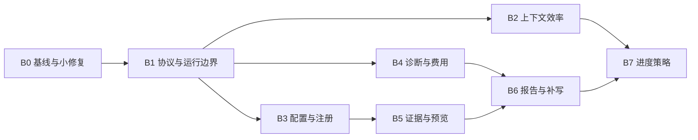

# ARTEX 引入 Pojun 能力的实施、优化与兼容方案

版本：设计 v1，2026-11-12。ARTEX 基线 `edf7c99`，Pojun 基线 `dc9b83ea125bb54c69dd38be5c29c26d8e83b811`（v0.4.63），依赖参考 Norma v0.4.4。

**建议：保留 ARTEX 当前运行与数据基座，分批移植有价值的能力；优先修正模型协议、状态边界和上下文查询，再做证据与报告，最后启用会主动改变执行行为的功能。** 不做整仓合并，不换框架，不增加第二套任务调度器或证据存储。

本文件是可实施设计，尚未实现的接口、字段、阈值均明确为“拟新增/起始值”。不把设计目标表述成已通过的性能结果。源码依据见 [第一轮评估](POJUN_SOURCE_REVIEW.md) 和 [扩展评估 E01–E18](POJUN_SOURCE_REVIEW_EXTENDED.md)。后者包含本轮新发现的并发、查询、归属和迁移问题。

## 1. 当前完成状态与不可回退的能力

已本地完成：`3a82997` 的六项执行恢复修复，`edf7c99` 的终态时钟重置、created 状态修正和前端缓存修复。已记录 PostgreSQL 全量测试及构建通过。当前运行安装仍为 0.3.20，后续本地提交尚未部署。

集成必须保留以下契约：

1. 执行是否发生、进程是否退出，以执行器回执为准；模型文本只能解释证据，不能替代回执。
2. 未确认的写操作继续受执行恢复屏障约束；用户/Planner 明确停止不能被后台自动重开。
3. 任务策略优先级、来源任务只读隔离、报告 evidence_version、并发准入与 FIFO 不变。
4. 数据库和内存的任务状态同步提交；删除、暂停、服务退出使用已有运行管理链路。
5. JWT/session epoch、HttpOnly cookie、来源检查、原有 API 和 Windows 便携启动保留。
6. 本次方案不改变线上任何配置。此前对任务 #1 的执行恢复授权不自动扩展为报告补写、目标登录自检或自动收尾授权。

## 2. 完整工作清单

“适配”保留主要实现并做兼容；“改写”保留机制，在本地基座实现。“高/中”表示实施优先级。B0–B7 是建议主线，X1–X3 是条件扩展。每个批次继续拆成小提交，不能把整张表塞进一个 PR。

| ID | 能力 | 方式/优先级 | 批次 | 主要落点与来源 |
| --- | --- | --- | --- | --- |
| A01 | 运行代次、旧协调器取消、晚到写入隔离 | 本地增强/高 | B1 | server/engine_timeout.go、manager.go、db 任务状态方法；E18 |
| A02 | Gemini 工具调用签名及跨模型历史兼容 | 适配/高 | B1 | third_party/norma/llm、harness、noaadapter |
| A03 | Anthropic 兼容用量归一与去重 | 适配/高 | B1 | norma/llm、agent/capture.go、db/llm_usage.go |
| A04 | 输出 UTF-8 边界、可靠全文引用 | 适配/高 | B1 | norma/tool、执行回执输出存储 |
| A05 | thinking 参数拒绝后的单次降级 | 改写/高 | B1 | agent/provider.go、server/task_llm.go |
| A06 | Worker 专用快照、按需展开、正文预算 | 改写/高 | B2 | agent/tools.go、worker.go、db 查询；E01/E02 |
| A07 | 压缩分块、部分结果复用、失败退避 | 改写/高 | B2 | agent/compaction.go、db/digest.go |
| A08 | MCP 失败冷却和发现去重 | 改写/中 | B3 | server/mcpdiscover.go、assembly.go |
| A09 | 技能索引、元数据和只读工具声明 | 适配/中 | B3 | agent/assembly.go、tools.go、toolcatalog.go、server/skill_tags；E17 |
| A10 | 配置参数校验与 DSL 空值查询 | 适配/高 | B0 | server/server_mgmt.go、platform_tools.go、db/asset_dsl.go；E06/E07 |
| A11 | 类别规范键、原始类别和 CWE 并存 | 改写/中 | B3 | db/findings.go、finding_recorder.go；E08 |
| A12 | 内置提示词/规则版本迁移 | 改写/高 | B3 | db/config.go、内置规则 seed；E11 |
| A13 | 规则级 judge/timeout 的完整语义 | 适配/中 | B3 | intercept、guard、规则 UI；E12 |
| A14 | 结构化失败原因、执行耗时、Planner 诊断摘要 | 改写/高 | B4 | guard、execution receipts、db/activity；E03 |
| A15 | 价格版本与任务成本查询 | 改写/高 | B4 | db/llm_usage.go、server/cost.go、费用 UI；E05 |
| A16 | 只读宿主工具/运行环境/代理诊断 | 适配/中 | B4 | server/platform_tools.go、拟新增诊断模块；E09 |
| A17 | 任务附件与 finding 关联、来源追溯 | 改写/高 | B5 | evidence/store.go、拟新增 db/task_artifacts.go |
| A18 | JSON/CSV/JSONL/文本/gzip/ZIP 预览 | 适配并优化/高 | B5 | 拟新增 server/artifact_preview、前端 viewer |
| A19 | 图片缩放、缩略图、Office/PDF 可选预览 | 适配/中 | B5 | 前端独立组件、docpreview 转换器 |
| A20 | 离线响应差分、证据回验、关联建议 | 改写/中 | B5 | evidence 纯函数、finding 工作流；E13/E16 |
| A21 | Word/Markdown 统一交付与证据清单 | 适配并优化/高 | B6 | report、server/finding_traffic_export.go |
| A22 | 可暂停、去重的报告补写 | 改写/高 | B6 | db/trigger_queue.go、finding evidence_version |
| A23 | 软预算、重复调用提示、进度观察、自动收尾 | 改写/中 | B7 | agent/engine 生命周期；E04 |
| A24 | 错误边界、WebView 降级、增量列表与请求去重 | 适配并优化/高 | B0/B5 | web/src/app、hooks、lib/api.ts；E10 |
| X01 | 任务凭据配置与显式登录自检 | 可选重写 | X1 | task_auth、任务受控 HTTP 执行；E14 |
| X02 | 只读 NVD/KEV/GHSA 情报和版本候选匹配 | 可选适配 | X2 | vulnintel 数据层与索引；E15 |
| X03 | Playbook 元数据、环境标签和模板筛选 | 可选适配 | X3 | 现有 task_templates、skill 元数据；E17 |

不作为本轮主线：C2/监听器/SSH 中继、自动安装宿主工具、自动扫描模板、自动复测、品牌/模块/环境变量改名、全局 1M 上下文或固定 65536 压缩输出预算。避免把产品范围扩展混入基础可靠性升级。

## 3. 代码结构：复用现有边界，不另造平台

| 位置 | 职责 | 不应承担 |
| --- | --- | --- |
| third_party/norma | 协议解析、流事件、工具输出边界、执行观察器 | ARTEX 的任务策略和数据库调度 |
| agent | 按角色组装上下文、工具定义、压缩及摘要 | HTTP 状态码、全局迁移、独立后台守护进程 |
| db | 事务、状态 CAS、分页查询、持久队列、版本检查 | 模型调用、文件转换、外部请求 |
| evidence | 内容哈希、落盘、完整性与引用生命周期 | 凭据配置、重开任务 |
| server | 请求验证、准入和取消、调用上述组件、DTO | 在 handler 中重复拼完整业务事务 |
| report / docpreview | 纯渲染；可取消的本地转换 | 直接查全局资产、触发新探测 |
| web | 展示、交互、请求缓存和失效 | 推测后端状态、从模型文本推测执行成功 |

只在出现第二个实际调用方时提取共享组件。小型受锁状态优先 mutex，不使用发布后仍修改的 atomic.Pointer；不新增通用 DAG 调度框架、全局事件总线或包罗万象的 Repository 接口。新增 DTO 使用明确结构体，逐步替换本次触及的 map[string]any；不顺带重写整个旧模块。

所有网络/数据库/转换操作传 context，后台任务进入现有 background/runTaskRoutine 管理。集合、重试、缓存、队列都有容量和期限；不会因加入“优化”而产生无限 goroutine、无界 map 或隐式全表扫描。

## 4. 模型与运行兼容（B1）

### A01：运行代次

拟新增 `tasks.run_generation BIGINT NOT NULL DEFAULT 1`。首次生成从 1 开始；终态重新准入或明确开启新一轮时在准入事务内递增；普通 pause/resume 不递增、不重置绝对预算。各在途操作持有开始时的 generation。

- 任务状态/Planner 意图写回：同一事务锁定 task 行并检查未删除、generation 匹配、目标前置状态正确，旧轮返回明确的 stale-run 错误，不能自动重试成新轮写入。
- 旧超时协调器：保存可取消句柄，重开时取消旧句柄并清理；新协调器按新 generation 注册。数据库检查仍是最终防线。
- 晚到执行回执：无论 generation 是否旧，都可追加并归属原 execution_id，不能丢掉退出结果；是否恢复任务再走当前策略和版本检查。
- 报告任务：按 finding.evidence_version 独立保护，不能把“原任务已结束”误判成禁止完成已有报告。
- 清理：先阻止新操作，再取消，再有界 drain，最后处理文件。保持现有删除屏障。禁止只让外层超时返回、放任未受管理的 planner goroutine 继续写。

验收需确定性交错：旧轮暂停在提交前→任务结束并重新启动→旧轮释放；旧轮不得修改新轮状态，但旧工具退出回执可见。覆盖 done/failed/timeout、FIFO、服务关停和删任务。

### A02–A05：保留协议扩展，统一重试边界

按源码小块移植到固定 Norma，不把 go.mod 的 replace 改回远程 fork。为每个修改记录上游版本/函数和本地差异，直接改源码，不生成运行时补丁。

- thought_signature 从流解析、并行 tool index、累积器、harness 输出、transcript、历史重放一贯保留；仅在适用协议输出。跨 Anthropic 请求剥离不支持字段但不修改原历史。对于严格的兼容网关，按 provider 能力配置处理扩展，不靠 URL 包含 google 判断。
- 用量先在协议适配层转成明确语义：输入/缓存的 echo 去重，累计输出与增量输出明确区分。不能把所有协议都无条件套一条 max/add 规则。完成/失败/中断都输出单次调用事实。
- 输出截断按 UTF-8 边界处理；主存储保存全文，显示层保留头尾和引用。绝对路径只在内部工具环境使用；恢复审阅和前端用 execution/artifact ID 解析，不能把模型给的任意路径直接拿来读文件。
- thinking 降级只认明确参数拒绝，最多一次；重建临时 provider，同时处理 profile 和单次 request override。已有可见输出或已执行工具时不重放。取消、配额耗尽、凭据错误、未知 400 不参与该降级。
- 维持已有 client_compat、session header、工具审批、连接池和 profile failover。provider 缓存键至少包含 profile ID/版本、wire format、有效参数；编辑配置统一失效。
- 不自动修改用户保存的模型窗口/预算，不用 Pojun 的单一模型经验为全部模型设置新默认值。

测试使用本地 mock SSE/HTTP 服务，覆盖三种协议、并行签名晚到、usage 仅在 delta、重复 echo、stream/non-stream、取消后不重试、跨 provider 历史、中文/emoji 截断、磁盘不可写和嵌套工具回执。

## 5. 查询与上下文效率（B2）

### A06：WorkerSnapshot

拟在 agent 定义明确的 WorkerSnapshot，由 db 提供有界读取。内容包括当前 intent/detail、有效约束与范围、相关父节点/事实、少量近期 findings/facts、来源任务的只读摘要、待核验执行和全文引用。必须保留来源及 confidence，不能用“瘦身”删掉约束或把继承资料变成本任务授权。

查询结构：一条聚合 count + 按任务/类型/排序列取有限摘要；必要时用一条多 CTE 投影。禁止先拿 1000 个完整节点再 count；禁止为 Worker 构建完整 coldGraph 后删字段。摘要采用稳定顺序和固定分段，减少无关前缀变化。

起始验收预算：当前任务快照最多 4 次 SQL 往返；继承任务批量读取，查询次数不随来源任务数量线性增加。软目标为非必要摘要最多 8k 估算 token；约束超预算必须报告超限并分层加载，不能静默截掉。完整 detail、证据和相关节点通过现有只读工具按需展开。

现有 graph_overview API 保留。新增内部快照不改变旧响应。相关读取使用已有只读/并发工具标记；每个工具要逐个检查实际副作用，不能按名称含 get/list 就判断只读。

### A07：压缩不重复付费、不抢主任务资源

按估算 token 而非固定 6 个节点分块，成员数量作为二级上限。先同步确定分块与输入指纹，再交给有界 worker pool；起始并发 2，总输出/时间受独立压缩预算控制并遵守 provider 限流。

可复用的块结果以 `(exploration_id, input_hash, prompt_version, provider_config_revision)` 定位；输入包含节点版本、关系、置信度与顺序。缓存持久化到专用小表，规定字节/记录限额和 TTL。不会把尚未成功的整个块标为已压缩。重试只补缺块；生成最终 digest 时重新检查节点版本、热节点和任务代次，冲突则保留原节点视图。

失败退避采用有上限的指数退避与少量抖动；取消、暂时无模型与实际模型失败分别计数。每次压缩有预算上限，后台停止受服务 ctx 管理，不使用无条件 WithoutCancel。先做分块和重试基准，跨运行缓存确有收益后再启用，避免为了省一次短摘要引入重型缓存。

## 6. 配置、注册与元数据（B0/B3）

### A10–A13：先守住老配置再支持新语义

- Enum 校验以返回规范值的函数实现，REST、agent 平台工具复用；错误返回 400 和稳定 code/field。保留 error 文本让老客户端能展示；数据库 CHECK 不移除。
- 字段缺省、显式 null、显式零/false 分开处理。更新 API 不把未提供的密钥/开关/绑定重置。
- DSL `field==""` 在可空文本列同时匹配 NULL/空串；参数仍参数化。其他运算符不改，文档提供明确例子；测试验证结果集，不只检查拼出的 SQL 字符串。
- 分类拟新增 `vulnclass_key` 与可选 `cwe_ids`，原 vulnclass 原文保留。未知类别保留，不靠归一化自动合并历史 findings 或改变去重指纹。
- 内置项使用稳定 builtin_key、版本及完整旧值 fingerprint；只更新可证明未编辑的默认项。与用户编辑同锁同事务比较 current_prompt_id/规则版本，用户编辑优先。无法判定来源的旧项显示“可更新”，不自动覆盖。
- 规则迁移把 enabled、priority、match_target/type、pattern、action、timeout、工具绑定纳入判定；完成标志与实际修改同事务提交。一次性版本 flag 不能阻止后来新增内置项按 key 幂等补种。
- 如支持显式 judge，协议值、DB 约束、API、UI、Guard 同批交付；规则局部 timeout 覆盖全局的优先级写进有效策略快照。未知 action 或读取失败不放行。已有规则不自动从 deny 改 judge。

### A08/A09：单一注册来源，有界缓存

MCP 冷却以 server 实例内的 `(MCP ID, config revision)` 为键；首次失败后的起始退避 2s，逐步到 60s，持续故障可到 5min。容量有限，配置编辑、刷新和成功连接失效；同键发现用 singleflight 合并，不跨任务随意共享有状态 stdio 会话。错误必须可见，用户手动刷新可立即试一次。

技能索引只取已绑定且可见的元数据，限制总字节/条数；缓存按目录/绑定版本失效，保留短 TTL 作为外部手改文件兜底。工具角色与只读属性来自一份 descriptor；由它派生本次新增工具的注册列表和 schema，先消除新功能漂移，不一次性重写所有工具。系统提示只附名称、简述和加载方式，技能正文按需加载。

## 7. 可观测性与费用（B4）

A14 复用 receipts、activity 和 llm_usage。新增轻量原因 DTO：`execution_id, intent_id, run_generation, phase, reason_code, elapsed_ms, decision_source`。Planner 拿按意图汇总的最近少量原因与引用；完整证据仍在详情页。平台策略阻止、未知执行、审批等待、任务取消、模型失败、环境错误、目标响应分别统计。原 blocked_reason 保留兼容，不能从其自由文本解析出机器恢复指令。

A15 在 llm_usage 上增补稳定调用 ID、attempt ID、profile ID/配置版本；新调用用于精确归属，历史未知维度保持 unknown。计量重试入库用唯一键去重，不把真实第二次模型调用与数据库重试混为一谈。

拟新增价格版本表，维度为 profile/model/currency/effective_from，包含输入、输出、cache-read/write 每百万 token 单价。费用用 NUMERIC/定点算术，API 金额返回十进制字符串；未知价格为 null，并给出未定价调用数，不能算作零。保留价格来源/版本，让历史可解释。不同币种分组返回，不无汇率依据地相加；先按协议归一“输入是否含缓存”再定价，防止缓存重复计费。不在线硬编码猜测最新公价。

大表查询先限制 task/time window，再 GROUP BY；索引与 EXPLAIN 结果对应。只有实际查询超预算才增加按日聚合和游标补算；不能每次开页面都扫全量历史，也不先引入独立分析数据库。

A16 只读诊断区分 executable found、version checked、capability confirmed、unknown。LookPath 不等于可用；版本检查有短超时、输出限额与缓存，默认不启动外部目标交互。Linux、Windows 分平台探测；代理诊断复用相同协议与出网配置，不以“能访问某个 GitHub URL”代替所有服务可达。页面给原因与处理入口，默认不安装软件、不改全局代理。

## 8. 证据、预览与报告（B5/B6）

### A17：一个内容存储，多种引用

复用 `evidence.Store` 的哈希、暂存写入、完整性校验和延迟 GC，不另建按任意相对路径访问的第二套附件库。拟新增：

- `task_artifacts`：任务拥有者、显示名、媒体类型、大小、blob hash、来源 execution/intent、创建时间。DB task/finding ID 用与现有主键一致的 BIGINT；API 延续当前字符串任务 ID。创建时锁定并检查任务可写。
- `finding_artifact_bindings`：finding_id/artifact_id/role/source/binding_version，支持同一证据服务于多个 finding；联合唯一键防重复，跨任务写入在事务内拒绝。任务级材料不会自动进单漏洞报告。
- `artifact_previews`：artifact_id/input_hash/renderer_version/state/lease_token/lease_until/attempts/next_attempt_at/output refs。只是可重建派生数据，由受管理的有界转换 worker 消费，不新增任务调度引擎。

先写临时文件、校验哈希、原子落盘，再提交引用。SQL 失败留下的无引用文件由既有延迟 GC 清理；GC 必须合并新增引用类型，不能只看旧流量引用。附件改绑、替换或删除同时递增 finding.evidence_version；手工删除报告/不再需要报告应有明确状态，不能被补写器误恢复。

任务删除和 finding 保留策略必须遵从现有行为：附件关联 finding 被保留时保留相应 blob，解除已删除任务的可写拥有关系；留存元数据可保存原任务标识用于审计，但不能用该标识继续授权写入。实际 FK 的 SET NULL/删除由现有删除选项决定；不要直接给新表 ON DELETE CASCADE。归档 manifest 记录 artifact ID、hash、binding 和版本，恢复时映射 ID，重新校验引用，派生预览可以重建。

### A18/A19：预览是有界派生结果

起始限额（实施后用基准调整）：普通文本/gzip 解压输出 20 MiB，显示 100 行、最多 64 列、单值 1 KiB；读取限额多 1 字节用于准确判断 truncated，响应给截断原因，不伪造 total_rows 为精确总数。JSON 使用流式 Decoder/UseNumber，行数与嵌套深度双限；达到预览上限后停止物化后续对象，不能先 Unmarshal 整份文件再取前 100 行。对象键顺序稳定，JSONL 后出现的新列补齐旧行。分页游标绑定 input_hash，文件变更后旧游标失效。

ZIP 只列目录，不解压执行；用文件 ReaderAt 读原文件，不把截断字节当完整 ZIP。在调用 ZIP reader 前检查中央目录字节/条目上限及 ZIP64 字段；超过初始 10k 条目或 8MiB 目录预算就明确不预览，不能等 reader 已分配全部元数据后才截断。另给名称长度、响应大小上限。HTML/XML 等按纯文本预览，不直接注入页面。

图片先限制文件和解码像素数，再使用现有 Go 依赖中的成熟缩放算法；先测 CPU/峰值内存再决定是否需要 ImageMagick。不得默认调用 Windows 的 convert.exe。缩略图按 `(hash, size, renderer_version)` 缓存，通过 singleflight 防并发重复生成。

Office/PDF 转换属于可选 renderer。检测 LibreOffice/poppler 后才提供预览；缺失时仍可下载原文件。每个转换有独立临时目录、有界进程数、超时和进程树清理，临时目录位于最终存储同盘以保证 rename；取消/崩溃后的 pending 通过 lease 重新领取，旧 lease 不得覆盖新结果。默认最多 3 页、120s、同实例并发 2，作为起始值测试，不把安装依赖捆绑到 ARTEX 必须启动的路径。

图片 UI 采用 Pointer Events、滚轮和显式放大/缩小/重置按钮，支持键盘、触摸、焦点和按需加载；大图 transform 按动画帧更新，避免每次 mousemove 触发整页重渲染。

### A20：证据回验与差分

离线 diff 输入是两个当前用户有权读取的证据 ID/版本，比较状态码、结构、字段类型、规范化正文；采用 UseNumber、深度/字段数上限、稳定键排序。不默认联网、不按字段多寡断言漏洞成立。噪声字段来自可配置列表，原文保留可查看。

回验优先核对 execution/finding/artifact 的确切引用。文本子串匹配仅作为辅助提示；未匹配可能是旧轮输出、附件或截断，不等于伪造。界面区分 matched/not_found/not_checked，允许查看来源。

关联建议优先 execution_id/intent_id、明确 source_url 和 asset_id；文本主机交集仅给建议，不在 GET 中修改归属。人工确认用 binding_version CAS；重复操作幂等，旧建议不能覆盖人工改绑。

### A21：报告只消费固定证据快照

沿用现有 Markdown/CSV，新增 Word renderer；三者使用同一 `ReportSnapshot`，减少查询与模板规则漂移。snapshot 含 task scope、findings 及 triage、证据版本、binding、资产可读名、复测结果和附件 hash。短事务固定有界元数据后退出，排版/压缩/文件读取不能占着 DB 事务或全局锁。超大集合转后台快照，不保持长事务；导出中的快照持有 blob 引用直到完成/到期，避免 GC 或删除任务在导出途中移除文件。

资产计数和附录必须走当前任务范围查询，不调用全局 QueryByType。风险接受/误报等过滤为显式选项，输出列出所用过滤策略和生成时间；不默认隐藏用户需要交付的结果。对已保留但来源任务已删除的 finding，按留存权限导出，不借此查询其他任务。

正文、图片和表格写入 OOXML 前做正确转义。图片数量/总字节/文档大小有上限；超量报告进入后台导出并显示状态。导出缓存键包含全部 finding.evidence_version、report_evidence_version、artifact binding version、过滤条件和模板版本；任何相关修改失效。下载文件名、ZIP 内路径和 Content-Disposition 均规范化。

### A22：报告补写复用持久触发队列

给现有 `trigger_runs` 增加专用报告任务元数据：finding_id、expected_evidence_version、job_kind、dedupe_key、状态/租约。可放在一对一元数据表，避免破坏现有通用触发记录。唯一键以 finding+evidence_version+job_kind 保证同时只有一份自动补写工作；人工重试复用 job 增加 attempt，而不是不断插入等价工作。

状态：pending → leased/running → completed；失败 → retry_wait；用户暂停/手工删除报告/任务暂停 → parked；重试耗尽 → needs_attention。超时/关停与真实模型失败分开计数。模型配置尚未就绪或领取被取消不消耗尝试；attempt 表以唯一 token 记录实际发起调用。租约有效且证据版本匹配才可提交，旧 worker 的迟到结果只进历史。

候选条件放进 SQL：enabled、due、未删除、未主动停止、尝试未耗尽，再 ORDER BY due_at,id LIMIT 并 `FOR UPDATE SKIP LOCKED`。不能先选最新 20 个再内存排除，不能把 7 天当硬性漏报边界。先扫描清单并统计，不在安装升级时自动调用模型。

报告任务使用专门的只读证据工具集加唯一写报告入口；不注册 Bash、目标 HTTP 请求或新探测工具。调用 update_finding_report 必须提交 expected_evidence_version。默认不覆盖已有人工报告，证据变化只标记 stale 并由策略决定是否重写。

重试起始方案：最多 6 次实际失败，延迟 15min/1h/4h/8h 后封顶，持久化 next_attempt_at；设置可调整。新安装/升级均默认关闭自动补写，提供“检查缺报”和手工单条/批量补写。任务 #1 的 execution recovery auto 不等于 report recovery auto。

## 9. 软预算与自动收尾（B7）

先上线 observe：记录每个意图真实调用增量、最近有效进展、重复输入及等待原因，不改变执行。再允许任务选择 suggest，最后才是显式启用的 stop 模式。

进度来源为已提交的语义变化：新证据 hash、新/变更事实版本、明确阴性结论、目标推进；同内容重复写回不算增量。三分钟内运行一条长工具、等待审批、MCP 建连、已有工具未收回执，不按“没写回”判空转。轮次统一用完成的模型工具批次/时间窗，不把一轮并行五个工具算成五轮。

重复提示使用有界 LRU+mutex，输入按 JSON 类型保真规范化，键包含 tool/config/input；动态轮询工具排除，最近结果变化/任务进度变化重置。默认最多一次提醒，不实现“拦两次后自动放行”这一难以解释的状态机。

软预算从 A03/A15 的实际调用增量计算；给意图收尾预留预算。模型上下文上限、单次输出限额、意图总用量和任务墙钟是四个不同设置，不能混用。硬停止必须取消受管理 ctx，回执完整落盘，写入明确 stop_reason；任何未知写操作都进入已有 recovery 机制。

自动收尾不得宣称 goal met。只有已验证目标条件满足才能 done；低进度、预算、覆盖阈值只是结束原因。覆盖率分母取当前任务版本，来源任务和用户新增目标应重置观察窗。主线验收通过前默认 off；数据库读配置失败不能转为更激进的默认启用。

## 10. 前端、API 与 Windows 兼容

拟新增接口示意（以同批实现 OpenAPI/类型定义为准，既有路由保持）：

| 接口 | 行为与并发控制 |
| --- | --- |
| GET /api/tasks/{id}/diagnostics | 只读摘要、真实能力/最近原因、可用性和观察时间 |
| GET /api/usage/cost?task=…&from=…&to=… | 可缺失价格的成本视图，金额字符串与 pricing_version |
| GET /api/tasks/{id}/artifacts?before=…&limit=… | 有界列表、opaque cursor；无全量正文 |
| GET /api/tasks/{id}/artifacts/{artifactID}/preview | input_hash/renderer_version/截断原因；无任意磁盘路径 |
| PUT /api/findings/{id}/artifact-bindings | expected_version + 引用列表，冲突 409 |
| POST /api/tasks/{id}/report-recoveries/scan | 仅生成缺报清单，幂等，不调用模型 |
| POST /api/findings/{id}/report-recovery | 显式排队；证据版本+幂等键，返回 job ID |
| PUT /api/tasks/{id}/report-policy | task-local，版本冲突 409；默认自动补写关闭 |
| GET /api/tasks/{id}/report-jobs | 已有持久队列状态投影，可分页 |

新字段一律添加，不重命名旧字段；已有 task 字符串 ID、分页和鉴权方式保留。新增错误 body 在现有 error 文本外添加 code/field，不突然把旧响应包成另一层。并发编辑使用明确版本值，旧 API 不因读取新元数据失败就返回错误的默认值。

前端沿用 Next.js 静态导出和现有组件体系。路由/global 错误边界分别覆盖；主界面提供重试，诊断详情按需展开。JSON clone helper 只接收 JsonValue，避免 Date/Map/undefined 被悄悄丢弃。媒体查询监听同时检测 add/remove 成对方法；SSR 首屏 snapshot 固定，避免 hydration 漂移。

列表请求由共享 hook 处理：同 key 去重，AbortController 取消过期请求，晚到响应不能覆盖新任务/新过滤条件；页面隐藏降低轮询，已有 SSE 路径沿用，不建立每个卡片一条连接。预览在展开后加载，详情组件动态导入；新增功能不扩大登录页初始 bundle。对数据量大的列表使用已有分页，只有实测长列表渲染超预算才引入虚拟化库。

Windows 保留已有 build/release/start/smoke 流程，不引入 systemd/hostd 依赖。文件使用 filepath、相同磁盘 staging、明确 UTF-8；子进程不弹窗，超时关闭进程树，空格/中文路径、文件占用和缺失可选工具必须测试。文档预览的失败仅影响预览，不能阻止服务启动或报告下载。

## 11. 数据迁移与回退设计

下列是拟新增存储清单，不是让启动函数散落执行的 DDL：

| 数据 | 演进方式 | 兼容/生命周期 |
| --- | --- | --- |
| tasks.run_generation | additive，既有行默认 1 | 参与新写入 CAS；旧运行记录 generation 可空并标为 legacy |
| llm_usage 调用 ID/profile ID/price version | nullable additive；新数据开始填 | 旧数据保留未知归属，不按名称强行反推 ID |
| model_price_versions | 独立版本表、时间索引 | 无价为 unknown，历史记录不得随改价被悄悄重算 |
| 内置定义 key/version/fingerprint | additive，逐项识别旧默认 | 未确认来源不覆盖；同时锁当前提示词/规则行 |
| findings.vulnclass_key/cwe_ids | additive，后台小批回填 | 保留原类别；不重写旧去重标识 |
| task_artifacts / finding_artifact_bindings | 正确 ID 类型、FK 与角色唯一键 | 接入删除、归档、恢复、GC、evidence_version |
| artifact_previews | 可重建、带 lease/token/version | 旧持有者不能提交；派生文件有清理限额 |
| report job metadata / attempts | 关联现有 trigger_runs | 保持通用 trigger 的旧格式和状态可读 |
| compaction block cache | 按输入/版本唯一键、容量与 TTL | 可关闭并清空，不影响原始节点 |

遵循 `coordinateWithSchemaMigration` 的现有协调机制。schema 迁移短事务提交，所有 backfill 按主键游标小批幂等执行，持久化进度；避免启动时持锁长时间全表 UPDATE。大表索引如需 CONCURRENTLY，应独立非事务迁移并能识别/重建 invalid index。外键先验证新写入，清理历史再 VALIDATE。

正式发布前冻结一份可回退基线：二进制、静态资源、数据库、配置、证据 blob 与任务目录的一致备份。备份/日志/文档不输出密钥。迁移后恢复演练必须检查报告与附件引用，而非仅检查服务能启动。

回退按两级处理：

1. 功能回退：关闭新报告/收尾策略，停止新 job 领取，有界 drain；保留所有回执、证据和新表。UI/预览/缓存可独立回退；任务基本执行不中断。
2. 版本回退：只退到经过新 schema 读写兼容测试的构建。涉及 generation、新 job 语义等写入约束后，不能承诺“直接替换为 0.3.20 二进制”安全。若无兼容旧构建，应恢复一致备份并明确恢复点后的数据处理，不能只回滚 SQL 或只替换二进制。

B0 加入 schema reader/writer 兼容版本检查到未来发布链路；它不能约束已经发布且不认识该检查的老二进制，所以回退支持矩阵必须写入 release 说明和便携启动校验。

## 12. 分批实施和依赖

| 批次 | 范围 / 建议提交拆分 | 前置 | 完成条件 |
| --- | --- | --- | --- |
| B0 | 固定基线与迁移兼容门禁；A10 enum/DSL；A24 错误边界与媒体查询 | 当前 edf7c99 | 旧客户端、缺省字段、NULL 查询、现代/降级浏览器测试；运行配置零意外变更 |
| B1 | A01 generation；A04 输出；A03 usage；A02 签名；A05 thinking，各自提交 | B0 | mock 协议矩阵与生命周期交错测试、执行回执套件、根/嵌套模块测试 |
| B2 | A06 WorkerSnapshot；A07 分块/退避，缓存另提交 | B1 | 上下文完整性与预算测试；数据库/内存基准达到目标，无热节点错误折叠 |
| B3 | A08 MCP；A09 技能/工具描述；A11 分类；A12 seed；A13 新规则语义 | B0/B1 | 新装/老库/手改默认/停用绑定迁移矩阵；MCP 编辑立即失效；不修改现有规则动作 |
| B4 | A14 原因 DTO；A15 定价/费用；A16 诊断 | B1 | 归属精确、未知不伪造、价格版本稳定、列表查询有界 |
| B5 | A17 存储/归档/GC；A18 数据预览；A19 图片和可选转换；A20 diff/建议；A24 增量 UI | B1/B3 | 大文件/压缩输入有界、跨任务引用拒绝、改绑版本冲突、删除恢复与 Windows 通过 |
| B6 | A21 snapshot/Word；A22 持久补写队列和 UI | B4/B5 | 多任务导出隔离；补写幂等/崩溃恢复/暂停/证据变更/重试上限全部通过 |
| B7 | A23 observe → suggest；可选 stop | B1/B2/B4/B6 | 观察样本证明不会误停长工具/等待审批；用户明确 task-local 策略后才进入 stop |

B0/B1 后可交付一次兼容性修复版本；B2–B4 后交付效率与诊断版本；B5–B6 后交付证据与报告版本。版本号在发布时确定，不把 Pojun v0.4.63 当作 ARTEX 下一版版本号。B7 的启用与代码发布分离。

### 三个条件扩展

- **X1 任务凭据**：在 B1/B3/B5 后做。Secrets 保存与普通配置分开，返回 has_secret 而非秘密；Headers/ExtraFields 也按可能含秘密处理。OS 保护密钥/加密存储需要完整备份和迁移方案。显式登录自检走任务范围、取消、代理、捕获和执行记录；重定向重新检查范围、跨域不转发凭据；三态结果 authenticated/unauthenticated/unknown，默认不在创建任务时自动请求。
- **X2 只读情报**：在 B3/B4 后做。独立受管理同步任务，按源共享限流，Retry-After 可取消，页数据与 checkpoint 原子提交。精确生态/包身份优先，倒排仅召回；版本未知就返回 unknown。保存来源、更新时间和判断依据；不自动运行 PoC/模板，不把候选直接变成 finding。
- **X3 Playbook**：在 B3 后做。复用 task_templates，增加标签、需求能力和内容版本；导入前可预览，用户模板保留。先提供筛选和绑定，预设内容单独评审，不全量替换当前 worker/planner 提示词。

## 13. 性能目标与测试门禁

以下是拟定验收目标，必须在同一机器和固定 fixture 上测出 before/after；本轮没有实测这些性能提升。目标不达标就优化或缩减范围，不通过调大超时掩盖回归。

| 场景 | 数据与测量 | 起始目标 |
| --- | --- | --- |
| Worker 快照 | 10k 节点、50k edges、至多现有来源任务上限；SQL 次数、alloc、序列化大小 | SQL 往返符合第 5 节；无完整图读取；非必要 prompt 字节较基线下降 ≥30%，不得丢约束/恢复引用 |
| 费用查询 | 100 万 usage 行，固定任务/时间窗口 | 本地 PG 热缓存 p95 ≤300ms；EXPLAIN 证明查询范围受索引约束；冷缓存单列报告 |
| 数据预览 | 20MiB JSON/CSV/gzip，含大整数/中文/深层对象 | 并发 2 时测增量峰值 RSS，单个普通预览起始预算 ≤128MiB；超限输入给明确信息而非 OOM |
| 预览并发 | 同一 hash 20 个并发请求 | 同一个 renderer 只生成一次；取消后不残留子进程/临时文件 |
| 压缩 | 200 节点含 1 个失败块、多次重试 | 同版本成功块可复用；并发上限与 provider 限流均有效；取消后受管理任务归零 |
| 队列 | 10k report jobs、重试耗尽项混入 | 领取 20 个 due jobs 不扫描/锁住无关完成历史；旧 lease 无提交权；不会饿死旧任务 |
| 前端 | 100 条列表、图片/数据预览按需打开 | 新增主路由 JS gzip 增量目标 ≤20KiB；大型 renderer 动态加载；无重复轮询风暴和晚到覆盖 |
| 停止/恢复 | 反复 pause/resume/delete/revive，进程中断 | 不遗失晚到退出回执；无跨代任务写入；goroutine/连接数在清理后回到稳定区间 |

必需测试不是对实现逐行复刻，而是按失效情形组织：

- 真实 PostgreSQL：新库、0.3.20 数据结构升级副本、edf7c99 基线、用户手改默认项、重复执行迁移、回填中断、旧/新客户端、并发变更。只用隔离库，完整备份恢复演练用匿名 fixture。
- 协议：本地 mock HTTP/SSE，无真实模型配额；断流/重复 usage/并行 signature/迟到响应/provider 切换。
- 执行：fake process 和本地 fixture，模拟启动后取消、退出晚到、磁盘失败/DB 成功、DB 失败/spool 重放、旧 lease 和旧 generation。
- 证据：跨任务 ID、软删除与留存、文件哈希不符、路径与归档 entry 校验、压缩输出超限、大数字保真、中文截断、报告版本竞争。
- 前端：正常 Chromium/Firefox/WebKit，另模拟缺少 structuredClone、旧 MediaQueryList、根布局异常；真实旧 WebView 支持范围以实机结果标明。
- 性能：Go benchmark `-benchmem`、数据库 EXPLAIN ANALYZE/BUFFERS、前端 bundle 与请求统计、进程峰值 RSS。保留原始结果，不引用 Pojun 生产统计冒充本地测量。
- 并发：关键包在支持的 CI 环境运行 `-race`；测试用 barrier/channel 控制交错，不以 1ms sleep 判断时序。

每批源代码完成后执行适用检查，避免反复无目的全量跑：根模块 `go test -p 1 ./... -count=1`（每次用全新隔离 ARTEX_PG_DSN）；Norma 改动必须在 `third_party/norma` 额外 `go test ./...`，根模块不会自动遍历嵌套 module。前端改动执行 tsc 和生产静态导出。最后验证普通构建、embedui 构建及 Windows 便携 smoke；Linux 在 CI 跑构建和转换/关停用例。

## 14. 默认行为与上线兼容矩阵

| 功能 | 老实例升级后 | 新任务 / 用户选择 | 回退方式 |
| --- | --- | --- | --- |
| NULL 查询、enum 错误、UI 错误边界、UTF-8 | 直接修正已定义行为；缺省字段兼容 | 不需要新开关 | 兼容构建回退 |
| generation / 签名 / 用量协议修复 | 下次受管理运行生效，不改历史记录 | 沿用当前模型配置 | 只退到认识新写入约束的构建 |
| WorkerSnapshot | 从下一条新 run 采用；不改正在运行会话 | 内部配置可暂退旧快照 | 快照策略回退，事实数据无迁移 |
| 压缩缓存 / MCP 冷却 | 按新配置 revision 生效；显式刷新可跳过一次 | 不改变工具授权 | 停用缓存/冷却，保留诊断 |
| 默认提示词/规则 | 仅可证明未编辑且声明兼容的默认项可更新 | 行为变化的规则动作不自动迁移 | 当前版本指针回退；历史保留 |
| 费用 / 标签 / 诊断 | 只读新增，缺失数据标 unknown | 价格/标签可单独配置 | 隐藏视图，不改 usage |
| 附件、预览、Word | 新入口，旧证据/旧导出不变 | 按需使用；外部 renderer 可缺失 | 关闭 renderer/新导出，原件继续可读 |
| 报告自动补写 | off；可检查缺报 | task-local opt-in，手工补写也需显式操作 | 停止领取并 drain，已写报告留存 |
| 预算/重复/自动收尾 | observe 或 off，无自动取消 | suggest/stop 由任务显式选择 | 切回 observe/off |
| 凭据自检 / 情报同步 / Playbook | 不自动启用、安装或发起请求 | 三个独立条件扩展 | 各自停用，不影响核心执行 |

## 15. 发布与完成定义

发布步骤：冻结候选提交 → 跑相应回归/基准 → 打包静态前端及二进制 → 隔离升级与恢复演练 → 核对配置差异 → 发布单个明确版本/tag → 部署后只读核对服务/队列/错误指标。禁止推送本地自动抓取的全部 Pojun tags。

任何一个工作包只有满足以下条件才算完成：

1. 直接修改并提交源码；来自 Pojun/Norma 的实现记录来源及许可证，保留已有许可声明。
2. 只有一个事实来源和一个写入入口；配置、DB、API、工具 schema、前端展示一致。
3. 新老数据/取消/错误/并发路径可解释；没有默默成功、默认扩大权限或无界重试。
4. 必要测试和性能记录随提交提供；计划阈值与实测值分开，不用“代码更优雅”替代证据。
5. 有功能开关或明确兼容回退路径；文档说明哪些默认启用、哪些需任务选择、哪些暂未实现。

当前本轮交付物是两份新增文档和可执行的分批设计。未改变模型参数、全局规则、任务 #1 策略、线上数据库或运行服务。下一步可从 B0 的 enum/DSL、错误边界和兼容门禁开始，每批通过后继续推进对应依赖，不需重做本次源码比对。

本轮文档核验：三个关联文档共检查 75 个 Markdown 链接，其中 59 个固定版本的 Pojun 源码路径在本地快照中均存在；24 个 A 编号和 3 个 X 编号完整且唯一。记录：`.local/pojun-plan-validation.json`。本轮仅修改文档，不重新运行代码测试，也未声称性能目标已达成。
